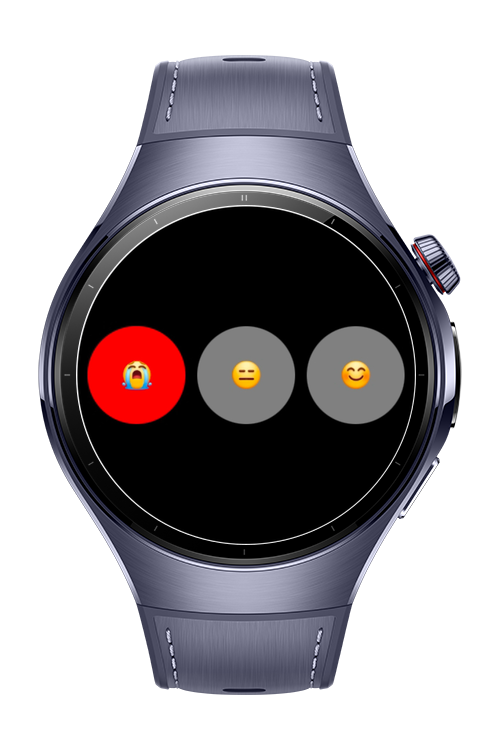
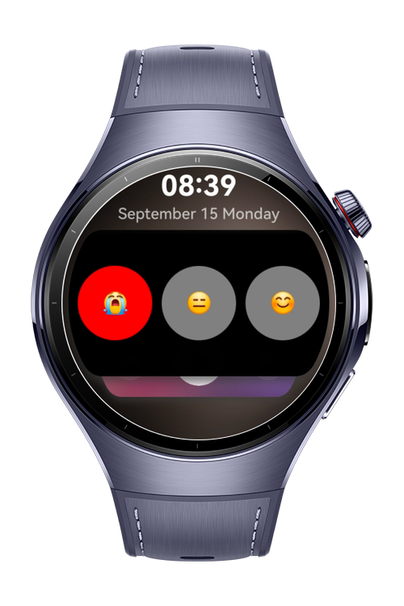

> **Note:** To access all shared projects, get information about environment setup, and view other guides, please visit [Explore-In-HMOS Index](https://github.com/Explore-In-HMOS/hmos-index).

# How To Create Card Widgets

This app shows how to create a widget (shown in the cards page of the watch), and implement two way data transfer.

# Preview

<div>
  
  
</div>

# Use Cases

- Use 2*3 widget. (Shown in the Cards page of the watch)
- Real time data transfer between app and the widget.

# Technology

## Stack

- **Languages**: ArkTS, ArkUI
- **Frameworks**: HarmonyOS SDK 5.1.0(18)
- **Tools**: DevEco Studio Version 5.1.1.830
- **Libraries**:
    - `@kit.FormKit`
    - `@kit.ArkData`
    - `@kit.IPCKit`
    - `@kit.SensorServiceKit`

## Required Permissions

- `ohos.permission.VIBRATE`
  > To add vibration feedback
- `ohos.permission.KEEP_BACKGROUND_RUNNING`
  > To run the app in the background

# Directory Structure

```
entry/src/main/ets/
├───entryability
│       EntryAbility.ets
├───entrybackupability
│       EntryBackupAbility.ets
├───model
│       FormIdData.ets
│       Mode.ets
│       ModeParcelable.ets
├───mymode
│   └───pages
│           MyModeCard.ets
├───mymodeformability
│       MyModeFormAbility.ets
├───pages
│       Index.ets
└───util
        ModePrefs.ets
        WidgetIdPrefs.ets
```

# Constraints and Restrictions

## Supported Device

* Huawei Watch 5

# License

**CardWidget** is distributed under the terms of the MIT License
See the [LICENSE](./LICENSE) for more information.